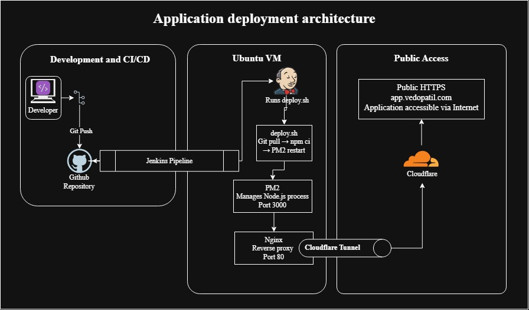
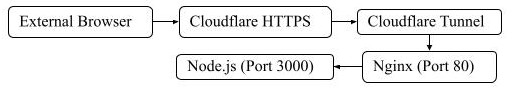

# Node.js DevOps Deployment – NextAstra Assignment

A simple Node.js application deployed on an Ubuntu VM using PM2, Nginx and Jenkins CI/CD, with public HTTPS access through Cloudflare Tunnel.

## Project Overview

This project demonstrates application deployment, reverse proxy configuration, automated CI/CD and basic application and system monitoring.

**Live Application:** https://app.vedopatil.com

**GitHub Repository:** https://github.com/vedopatil/nodejs-devops-deployment

## Technology Stack

- **OS:** Ubuntu 26.04
- **Runtime:** Node.js
- **Application:** Express.js
- **Process Management:** PM2
- **Web Server:** Nginx
- **CI/CD:** Jenkins
- **Version Control:** Git and GitHub
- **Public Access:** Cloudflare Tunnel

## Architecture

### 1. Application Deployment Architecture

<!-- Insert application deployment architecture flowchart below -->



### 2. Public Traffic Flow

<!-- Insert public traffic flowchart below -->



## CI/CD Workflow

1. Application changes are committed and pushed to GitHub.
2. Jenkins monitors the repository through SCM polling.
3. Jenkins automatically triggers the pipeline when changes are detected.
4. The pipeline executes three stages:
   - **Checkout:** Retrieves the repository and pipeline definition.
   - **Deploy:** Updates the application, installs dependencies and restarts it using PM2.
   - **Verify:** Checks application availability through its health endpoint.
5. The updated application becomes accessible through the public HTTPS domain.

## Application Endpoints

| Endpoint | Description |
|---|---|
| `/` | Application homepage |
| `/health` | Application health-check endpoint |

## Monitoring

Basic application and system monitoring is performed directly on the Ubuntu VM.

```bash
pm2 status
pm2 logs nextastra-app
pm2 describe nextastra-app
pm2 monit
free -h
df -h
top
uptime
```

## Deployment Architecture

The application runs locally on the Ubuntu VM:

- Node.js application: Port `3000`
- Nginx reverse proxy: Port `80`
- Jenkins: Port `8080` (not publicly exposed)
- Cloudflare Tunnel: Routes public HTTPS traffic to Nginx on port `80`

## Documentation

Detailed installation, configuration, deployment, monitoring and verification steps are maintained in the project documentation.

---

**Note:** This project is deployed on a local Ubuntu virtual machine. Public availability depends on the host laptop, VM, application and internet connection remaining operational.